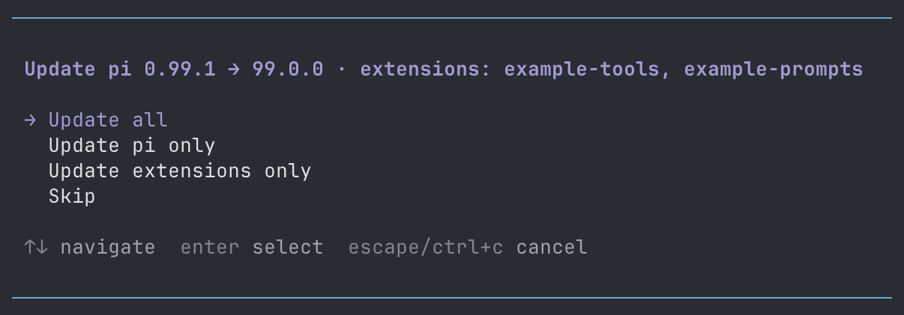

# pi-updater

pi-updater checks for [pi](https://pi.dev) and extension updates and lets you
install them from your current session.

- npm: https://www.npmjs.com/package/pi-updater
- repo: https://github.com/tonze/pi-updater



*Simulated updates.*

Pi already detects updates. This extension adds the prompt, installation,
and return to your session. Installation uses Pi's native `pi update` command;
pi-updater does not manage packages itself.

## Installation

```bash
pi install npm:pi-updater
```

Requires pi 1.0.0 or later. For older versions, pin `pi-updater@0.5.1`.

## Usage

Pi checks in the background when a session starts. If updates are available,
a notification lists them without taking input. Run `/update` to check manually
and choose what to install.

If only pi is outdated:

- **Update now** — run `pi update --self`, then restart pi on the current session
- **Skip** — close the prompt
- **Ignore \<version\>** — silence automatic notices for this pi version

If both pi and extensions are outdated, a combined prompt appears:

- **Update all** — run `pi update --all`, then restart
- **Update pi only** — run `pi update --self`, then restart
- **Update extensions only** — run `pi update --extensions`, then reload
- **Skip** — close the prompt

If only extensions are outdated, you're offered `pi update --extensions`.
Extension-only updates reload in place.

"Ignore" is only offered in the Pi-only prompt and suppresses automatic
notifications for that version. Manual `/update` checks still offer it.

Skipping an extension update does not suppress future notifications. Pinned (`@version` / `#ref`) and local packages are excluded,
matching pi's own update check.

In non-interactive modes, or if the restart fails, pi-updater falls back to
a message telling you how to restart yourself. Ephemeral `--no-session` runs
stay ephemeral across the restart.

If pi was updated next to the running version instead of in place, as the
pi.dev installer and custom update commands do, pi-updater asks you to restart
pi yourself.

The restart keeps the flags you started pi with. It leaves out the first
prompt and attached files and the flags that select a session. When pi
continues a saved session that already has messages, the restart also leaves
out `--provider`, `--model` and `--thinking`, because pi restores these from
the session. Once the session is saved to disk, it also leaves out `--name`,
so a name set with `/name` is kept. If pi was started with `--api-key`, or if
pi-updater cannot rebuild the arguments safely, it asks you to restart pi
yourself.

### How version checks work

The Pi version check uses Pi's update service. Extension checks use Pi's
package manager. The notification waits for both checks without blocking startup.
If the automatic version check fails, it can use a cached result.

After an update restarts Pi, the startup check is skipped once. `/update`
requests fresh results. Cache and dismissed-version state live in Pi's agent
directory and respect `PI_CODING_AGENT_DIR`.

### Demo

Run `/update --test` in an interactive terminal to preview a combined Pi and
extension update prompt. All updates shown are fixtures;
choosing an update action only simulates progress. The command makes no network
requests or cache changes and never installs, reloads, or restarts Pi. It also
works offline.

### Disabling checks

pi's standard environment variables are respected:

```bash
export PI_SKIP_VERSION_CHECK=1   # disable automatic checks
export PI_OFFLINE=1              # offline mode, also disables checks
```

While pi-updater is active it suppresses pi's built-in update notice so you
don't get notified twice for the same release. pi's "Package Updates
Available" banner cannot be suppressed the same way, so it may still appear
alongside pi-updater's notification.

## Limitations

Pi's native updater determines which installations can update automatically.
Standalone binary installs receive download instructions. Windows self-update
supports npm and pnpm installs only.

## Updating pi-updater itself

```bash
pi update npm:pi-updater
```

## License

MIT
